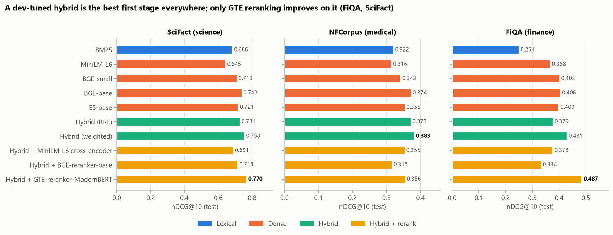
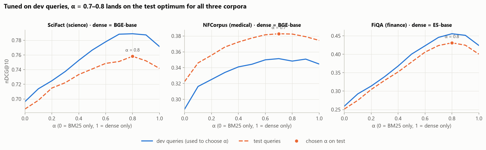
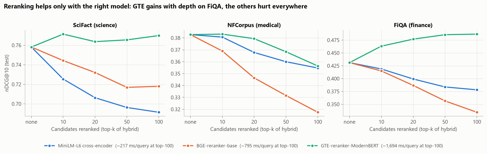
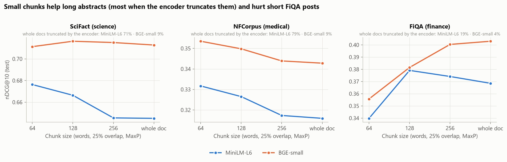
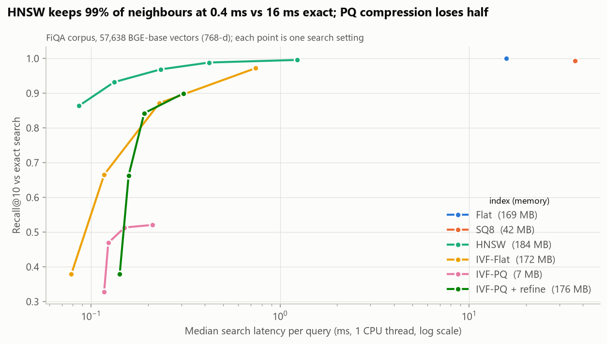
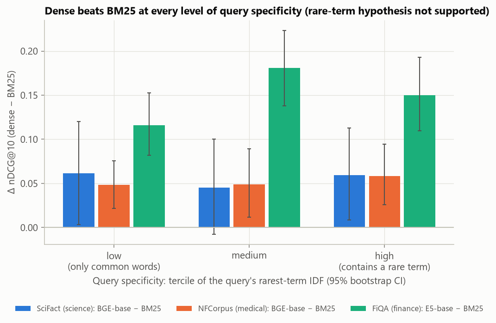

# RAG Retrieval Lab

[](https://github.com/ChetanYarlagadda/rag-retrieval-lab/actions/workflows/ci.yml)

**Which retrieval choices actually improve a RAG system?** This is a controlled, significance-tested benchmark of
the decisions every retrieval-augmented generation pipeline has to make: BM25 vs dense embeddings, which embedding
model, hybrid fusion, cross-encoder reranking, chunk size, and the FAISS index type. It runs on finance, medical and
science corpora.

In enterprise RAG (assistants over engineering manuals, support-case search, clinical documents) these settings
are often picked by habit: "use RRF", "always rerank", "chunk at 512". Here each one is changed in isolation.
Every tuning decision is made on a dev split, results are reported on a held-out test split, and each claim gets
a paired test.



## Key findings

| Corpus | BM25 | Best single dense | Tuned hybrid | Best overall | Gain over BM25 |
|---|---:|---:|---:|---:|---:|
| FiQA (finance) | 0.251 | 0.406 (BGE-base) | 0.431 | **0.487** (hybrid + GTE rerank) | +94% |
| NFCorpus (medical) | 0.322 | 0.374 (BGE-base) | **0.383** | 0.383 (no rerank) | +19% |
| SciFact (science) | 0.686 | 0.742 (BGE-base) | 0.758 | **0.770** (hybrid + GTE rerank) | +12% |

<sub>nDCG@10 on the test split.</sub>

1. **A tuned hybrid is the best first stage on every corpus.** Weighted BM25 + dense fusion beats the dense model
   it is built on (picked on dev) by +0.031 on FiQA (95% CI [0.021, 0.041], Holm p = 0.001), +0.017 on SciFact, and
   +0.009 on NFCorpus. The last two are not significant after correcting for multiple comparisons. The fusion weight α chosen on dev
   queries (0.8 / 0.7 / 0.8) turned out to be exactly the best α on test.
2. **Reciprocal rank fusion, the common untuned default, is significantly worse than tuned weighted fusion on all
   three corpora** (−0.010 to −0.053). On FiQA, where BM25 is weak, it even falls below dense-only retrieval.
3. **Reranking helps only with the right model.** GTE-reranker-ModernBERT adds +0.056 on FiQA (p < 0.001), but
   two widely used cross-encoders, MS MARCO MiniLM-L6 and BGE-reranker-base, make *every* corpus worse
   (−0.03 to −0.10). The deeper they rerank, the more damage they do.
4. **The first stage still matters after reranking.** On FiQA the same GTE reranker scores 0.057 lower on BM25
   candidates than on hybrid candidates. It can't recover documents BM25 never retrieved (Recall@100: 0.56 vs 0.75).
5. **The popular default embedding model loses to BM25.** `all-MiniLM-L6-v2` scores below BM25 on SciFact and
   NFCorpus. Its 256-token limit truncates 71–79% of those documents. Chunking helps it there (+0.03 / +0.02), but
   it hurts on short FiQA posts.
6. **The index is almost a free choice at this scale.** HNSW returns 98.8% of the exact top-10 in 0.42 ms, against
   16 ms for exact search. Product quantization cuts memory 25× but loses half the true neighbours unless the
   shortlist is re-scored with the exact vectors.

The pipeline was checked against published results first. All 12 dense-model scores match the official
[MTEB results](https://github.com/embeddings-benchmark/results) within ±0.002 nDCG@10
([`published_comparison.csv`](reports/results/published_comparison.csv)).

## Results

### Hybrid fusion: tune the weight, don't default to RRF



Weighted fusion min-max normalises BM25 and dense scores over the union of both top-100 lists:
`score = α · dense + (1 − α) · bm25`. The dense model and α are both chosen on the dev split. The solid line is
what the tuner sees; the dashed test line was never used for any decision.

| Comparison (Δ nDCG@10, test) | SciFact | NFCorpus | FiQA |
|---|---:|---:|---:|
| Dev-selected dense − BM25 | +0.055 \*\* | +0.052 \*\* | +0.149 \*\* |
| Tuned hybrid − its dense model | +0.017 | +0.009 | +0.031 \*\* |
| RRF − tuned hybrid | −0.027 \* | −0.010 \* | −0.053 \*\* |

<sub>Dev-selected dense model: BGE-base on SciFact and NFCorpus, E5-base on FiQA (BGE-base edges it on FiQA test,
0.406 vs 0.400). \* Holm-adjusted p < 0.05, \*\* p < 0.01. Paired bootstrap CIs and sign-flip randomisation tests
over queries, from [`significance.csv`](reports/results/significance.csv).</sub>

### Reranking: the model matters more than the decision to rerank



| Reranker on the hybrid top-100 | SciFact | NFCorpus | FiQA | Median latency (RTX 4050 laptop) |
|---|---:|---:|---:|---:|
| none (tuned hybrid) | 0.758 | **0.383** | 0.431 | — |
| MS MARCO MiniLM-L6 (22M) | 0.691 | 0.355 | 0.378 | ~0.2 s / query |
| BGE-reranker-base (278M) | 0.718 | 0.318 | 0.334 | ~0.8 s / query |
| GTE-reranker-ModernBERT (150M) | **0.770** | 0.356 | **0.487** | ~1.7 s / query (~0.16 s at top-10) |

All three corpora are already ranked well by the tuned hybrid. A reranker that judges relevance worse than that
ranking replaces it with a worse one, and the damage grows with every extra candidate it reorders. GTE keeps gaining
with depth on FiQA. On NFCorpus it is neutral at top-10 and harmful deeper. Rerankers need the same validation as
any other model before they ship.

### Chunking: fit the encoder, not a habit



Documents were split into 64/128/256-word windows (25% overlap, title prepended) and scored by their best chunk
(MaxP). Chunking pays off when the encoder would otherwise truncate (MiniLM on long abstracts). It fragments the
answer on short FiQA posts. These are single-run effect sizes without CIs.

### Approximate nearest-neighbour indexes



| Index (FiQA, 57,638 × 768) | Recall@10 vs exact | nDCG@10 | Median latency | Memory |
|---|---:|---:|---:|---:|
| Flat (exact) | 1.000 | 0.406 | 15.8 ms | 169 MB |
| HNSW, efSearch = 128 | 0.988 | 0.399 | 0.42 ms | 184 MB |
| IVF-Flat, nprobe = 64 | 0.972 | 0.403 | 0.74 ms | 172 MB |
| SQ8 | 0.993 | 0.406 | 36 ms | 42 MB |
| IVF-PQ (m = 48), nprobe = 64 | 0.521 | 0.316 | 0.21 ms | 7 MB |
| IVF-PQ + exact refine (k × 8) | 0.899 | 0.397 | 0.31 ms | 176 MB |

<sub>Single CPU thread, one query at a time.</sub>

### When does BM25 win?



The hypothesis going in was that BM25 wins on queries containing a rare exact term (tickers, drug names,
acronyms). The data doesn't support it. The dense model's lead is positive in every tercile of query specificity,
and no smaller for the most specific queries. BM25 still wins on 10–33% of individual queries, and that is the
room fusion exploits.

## Data

| Corpus | Domain | Documents | Test queries | Dev split |
|---|---|---:|---:|---|
| [SciFact](https://huggingface.co/datasets/BeIR/scifact) | scientific claims → abstracts | 5,183 | 300 | train (809) |
| [NFCorpus](https://huggingface.co/datasets/BeIR/nfcorpus) | nutrition / medical, graded relevance | 3,633 | 323 | validation (324) |
| [FiQA-2018](https://huggingface.co/datasets/BeIR/fiqa) | personal-finance Q&A | 57,638 | 648 | validation (500) |

All three come from the BEIR benchmark (Thakur et al., NeurIPS 2021 Datasets & Benchmarks) and are downloaded from
the Hugging Face Hub at run time. They are not redistributed here; see each dataset card for its license.

Models, all from the Hugging Face Hub:
[all-MiniLM-L6-v2](https://huggingface.co/sentence-transformers/all-MiniLM-L6-v2),
[bge-small-en-v1.5](https://huggingface.co/BAAI/bge-small-en-v1.5),
[bge-base-en-v1.5](https://huggingface.co/BAAI/bge-base-en-v1.5),
[e5-base-v2](https://huggingface.co/intfloat/e5-base-v2),
[ms-marco-MiniLM-L-6-v2](https://huggingface.co/cross-encoder/ms-marco-MiniLM-L-6-v2),
[bge-reranker-base](https://huggingface.co/BAAI/bge-reranker-base),
[gte-reranker-modernbert-base](https://huggingface.co/Alibaba-NLP/gte-reranker-modernbert-base).

## Method

- **Lexical:** BM25 (`bm25s`, Lucene variant, k1 = 1.5, b = 0.75), with English stemming and stopword removal over
  title + text.
- **Dense:** Sentence Transformers bi-encoders with each model's documented prefixes (BGE query instruction, E5
  `query:` / `passage:`), L2-normalised, and exact inner-product search with FAISS. fp16 on the GPU; on SciFact this
  changed nDCG@10 by at most 0.002 against fp32.
- **Hybrid:** reciprocal rank fusion (k = 60) and weighted min-max fusion. The weighted version uses exact scores
  for every candidate in the union of the two top-100 lists, so a document missing from one list isn't penalised.
- **Reranking:** cross-encoders score (query, document) pairs at a 512-token max length. The top-k is reordered by
  raw logits; the tail keeps its first-stage order.
- **Metrics:** nDCG@10 (graded gains, trec_eval convention), Recall@100 and MRR@10, implemented in
  [`raglab/metrics.py`](raglab/metrics.py) and unit-tested.
- **Statistics:** for every comparison, the per-query paired difference, a 95% percentile-bootstrap CI, and a
  two-sided sign-flip randomisation test (10,000 resamples), Holm-corrected across the 10 comparisons within each
  corpus.
- **Tracking:** every configuration is logged as an MLflow run (local SQLite store in `mlruns/`, git-ignored);
  the summary tables are committed under [`reports/results/`](reports/results/).

## Limitations

- Three English corpora with short-to-medium documents. Long documents, such as manuals or contracts, would stress
  chunking much harder.
- Each dataset's dev split is small (324–809 queries), and only one fusion weight was tuned. Rerankers were used
  off the shelf; fine-tuning them on in-domain data could change the reranking results.
- Latencies come from one laptop (RTX 4050, 6 GB, Windows, no FlashAttention). Treat them as relative, not
  absolute.
- ANN results are for 57k vectors. At millions of vectors, exact search stops being viable and the trade-offs
  shift.

## Reproduce

```bash
pip install torch --index-url https://download.pytorch.org/whl/cu128   # or the CPU build
pip install -r requirements.txt
python scripts/run_pipeline.py                  # full run: ~2 h on a laptop GPU, mostly cross-encoder reranking
python scripts/run_pipeline.py --max-queries 40 # smoke test: outputs go to data/cache/smoke/
python scripts/make_figures.py                  # redraw figures from reports/results/
pytest
```

Serve the best quality/latency configuration (BGE-base hybrid, α = 0.8, GTE reranking the top 10) as an API:

```bash
uvicorn app.main:app --port 8000        # Swagger UI at http://localhost:8000/docs
curl -X POST localhost:8000/search -H "Content-Type: application/json" \
     -d '{"query": "Vitamin D supplementation reduces fracture risk", "k": 5, "rerank": true}'
```

Environment variables `RAGLAB_DATASET`, `RAGLAB_EMBEDDER`, `RAGLAB_ALPHA`, `RAGLAB_RERANKER` and
`RAGLAB_RERANK_DEPTH` switch the corpus and configuration. On an RTX 4050 laptop the API answers in ~8 ms without
reranking and ~160 ms with it.

## Project structure

```
raglab/
  data.py         BEIR loading (corpus, queries, graded qrels; dev/test splits)
  retrievers.py   BM25 (bm25s) and bi-encoder dense retrieval (Sentence Transformers + FAISS)
  fusion.py       reciprocal rank fusion and weighted score fusion
  rerank.py       cross-encoder reranking
  chunking.py     word-window chunking with overlap, MaxP aggregation
  ann.py          FAISS index builders and latency/recall benchmarking
  metrics.py      nDCG@k, Recall@k, MRR@k
  stats.py        paired bootstrap + randomisation tests, Holm correction
  published.py    reference scores (BEIR paper, MTEB results repo)
  tracking.py     MLflow logging
  figures.py      all report figures
  plotting.py     shared colorblind-safe styling
app/              FastAPI + Pydantic search service
scripts/          run_pipeline.py (all experiments), make_figures.py
notebooks/        analysis.ipynb, the full walkthrough with tables
reports/          figures/ and results/ (every number quoted above)
tests/            pytest suite (metrics, fusion, chunking, statistics, BM25, API)
.github/          CI: pyflakes + pytest on every push (CPU-only, no data or model downloads)
```

## License

MIT; see [LICENSE](LICENSE). Datasets and models keep their own licenses.
